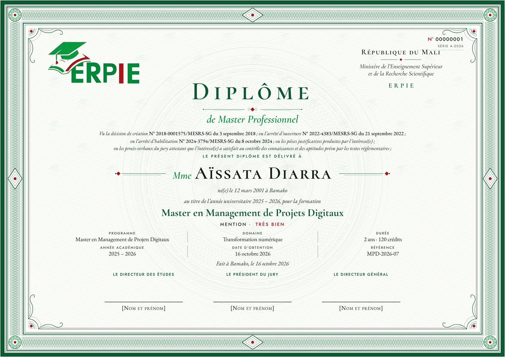

# ERPIE — Master diploma template

Official diploma template for ERPIE. A4 landscape (297 × 210 mm), print-ready, and exports to vector PDF.

The design is **full bleed**: the green border runs to the edge of the page. A print shop should print it on larger paper and trim to A4. A desktop printer will leave a thin white margin.



## Files

| File | What it is |
|---|---|
| `diploma-master.html` | The template. Every dynamic value is a `{{FIELD}}` token. |
| `sample-data.json` | Example values for every field. |
| `build.py` | Generates the template: engraved frame, guilloche, microtext. Edit this, not the HTML. |
| `assets/` | Logo and watermark emblem. |
| `exports/diploma-sample.pdf` | The template filled with sample data and printed to PDF. |

The logo files are in `brand/logo/` at the repo root.

## Filling the template

Use either of these methods:

1. **Server-side:** replace each `{{FIELD}}` token in `diploma-master.html` with its value (HTML-escape the values), then print to PDF.
2. **In the browser:** set `window.DIPLOMA_DATA = {...}` before the page loads, or call `ERPIE_DIPLOMA.fill(data)`. Empty optional fields hide their rows, and long names shrink to fit.

PDF export with Playwright/Chromium:

```js
await page.pdf({ width: '297mm', height: '210mm', printBackground: true });
```

## Fields

| Field | Notes |
|---|---|
| `SCHOOL_LOGO` | Image URL or `data:` URI |
| `SCHOOL_NAME` | Shown at the bottom of the institutional header |
| `COUNTRY` | Country / jurisdiction |
| `AUTHORITY` | *Optional.* Supervising ministry, e.g. Ministère de l’Enseignement Supérieur et de la Recherche Scientifique |
| `ACCREDITATION` | *Optional.* Extra line under the ministry. Empty by default because the decrees are in the body. |
| `DECREE_CREATION` | Creation decision, e.g. `N° 2018-0001575/MESRS-SG du 3 septembre 2018` |
| `DECREE_OPENING` | Opening order (arrêté d’ouverture) |
| `DECREE_HABILITATION` | Habilitation order (also covers the Master level) |
| `CERTIFICATE_NUMBER` | e.g. `00000001` |
| `SERIAL_NUMBER` | *Optional* |
| `DOCUMENT_TITLE` | `Diplôme` / `Certificat` |
| `QUALIFICATION` | e.g. `de Master Professionnel` |
| `RECIPIENT_HONORIFIC` | *Optional.* `M.` / `Mme` |
| `RECIPIENT_NAME` | Rendered in small caps |
| `RECIPIENT_BIRTH_DATE` | e.g. `12 mars 2001` |
| `RECIPIENT_BIRTH_PLACE` | e.g. `Bamako` |
| `PROGRAM_NAME` | |
| `DISTINCTION` | *Optional.* Mention |
| `SPECIALIZATION` | Domaine |
| `PROGRAM_DURATION` | |
| `ACADEMIC_YEAR` | Shown in the award line and the details row |
| `ISSUE_DATE` | |
| `ISSUE_CITY` | |
| `PROGRAM_REFERENCE` | *Optional* |
| `DIRECTOR_TITLE`, `DIRECTOR_NAME` | Left signature |
| `ACADEMIC_OFFICIAL_TITLE`, `ACADEMIC_OFFICIAL_NAME` | Centre signature |
| `AUTHORIZED_SIGNATORY_TITLE`, `AUTHORIZED_SIGNATORY_NAME` | Right signature |

## Rebuilding

```sh
python3 build.py                      # rewrites diploma-master.html and sample-data.json
python3 build.py --preview-out x.html # also writes the interactive preview
```

The frame and background are plain vector SVG. They don't use SVG `<pattern>`, because Chromium flattens patterns into 72 dpi images in PDF output.
